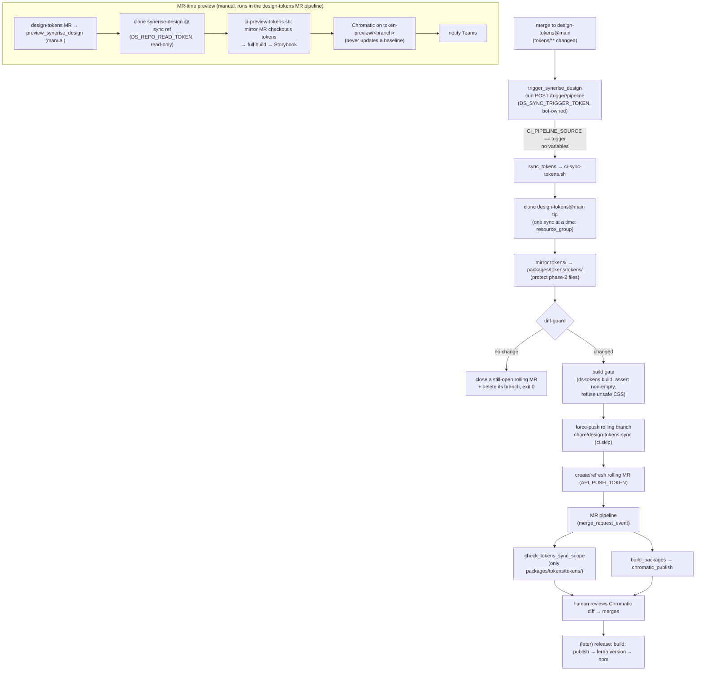

# 2. Design token sync flow (design-tokens → synerise-design)

- **Status:** Accepted
- **Date:** 2026-06-08 (amended 2026-10-22: decisions 1, 5, 6, 8 and 9, *Tokens and identities*,
  *What GitLab enforces*)
- **Deciders:** Design System / Frontend
- **Scope:** `Frontend/design-tokens` (source) and `Frontend/synerise-design` (this repo, project id `1171`)

> Operational runbook lives in [`packages/tokens/SYNC_AUTOMATION.md`](../../packages/tokens/SYNC_AUTOMATION.md).
> This ADR records *why* the flow is shaped the way it is; that doc records *how* to run and verify it.

## Context

Design tokens are authored in a separate repo, `Frontend/design-tokens`. The design system
consumes them as the `@synerise/ds-tokens` package inside this monorepo. We need token changes
to reach the design system **automatically**, be **visually reviewed** before they land, and
**not** trigger a package publish on their own.

Constraints that shaped the decision:

- Two repos, two pipelines, on a self-managed GitLab (`gitlab.synerise.com`).
- Tokens must be reviewed visually (Chromatic) — a JSON diff is not enough to catch regressions.
- Publishing `@synerise/ds-tokens` is a deliberate release step (`build: publish` → `lerna version`
  → npm); a token sync must never piggy-back a publish.
- The sync must fire **regardless of which person merges** in `design-tokens` — see decision 6,
  which supersedes the original `trigger:`-keyword approach.
- The token build must tolerate partial/drifted upstream content without hard-failing.
- Token values reach every consuming app as CSS, so they are untrusted input to this repo.

## Decisions

### 1. Canonical source is `design-tokens@main`; automation is merge-triggered in CI

Token JSON lives on `main` in `design-tokens` (`master` is retired, carrying only the
Secret-Detection template). A merge to `main` that touches `tokens/**` is the single event that
starts a sync. No scheduled polling, no manual copy.

The trigger carries no variables (decision 6), so the worker clones the **tip** of `main`: one
commit's tree, never a mix of two merges. Syncs run one at a time (decision 8), so each takes a tip
at least as new as the last.

### 2. One rolling MR, force-updated per change

The worker force-pushes a single rolling branch `chore/design-tokens-sync` and creates **or
refreshes** one open MR. The reviewer always sees "current tokens vs the target branch" in one
Chromatic thread instead of a pile of one-shot MRs. The MR is created with `squash: true` and
`remove_source_branch: true`.

The MR **target** is the branch the sync ran on (`CI_COMMIT_REF_NAME`, overridable via
`SYNC_MR_TARGET_BRANCH`), so the diff is exactly the token commit. Normally that is `master`;
**during the interim while tokenisation is not yet in `master`** the trigger fires on
`chore/tokenisation`, so the MR targets `chore/tokenisation` — and auto-reverts to `master` when
the trigger ref does. The target is also set on *update*, so an existing rolling MR is retargeted
if the target changes. An MR targeting `chore/tokenisation` still runs the full MR pipeline
(`install → build_packages → chromatic_publish`): those jobs gate only on `merge_request_event`
with no target-branch condition, and the token-sync specials key on the *source* branch.

### 3. The sync MR never bumps the package version

The sync commit/MR title is `chore(tokens): sync from design-tokens@<sha>`, deliberately **not**
`build: publish`. Merging it does not fire `publish_packages`. The next normal release picks up the
changed package files and publishes. Versioning stays with the existing release flow.

### 4. Mirror in Node, with protected repo-local files

`scripts/ci-sync-tokens.sh` mirrors `tokens/` → `packages/tokens/tokens/` using a small Node copy
(no `rsync`/`curl`/`jq` dependency — guaranteed available in the build image). It mirrors upstream
*removals* too, **except** phase-2 files that exist only here and must not be deleted:
`semantic/dimensions.json`, `semantic/spacing.json`.

### 5. Two safety gates before a branch is ever opened

- **Diff-guard:** if the mirror produces no change under `packages/tokens/tokens`, nothing is
  pushed. (A docs-only commit upstream is additionally filtered by `changes: tokens/**`.) An
  unchanged mirror can still mean the open rolling MR has gone stale: upstream reverted the change
  it carries, or it reached the target another way, and the MR is still ready to merge. So the
  worker then closes the open rolling MR, with a comment saying why, and deletes its branch so it
  cannot be reopened. Closing was chosen over force-pushing the target's state onto the branch:
  an empty MR would sit open with nothing to review, and the next token merge opens a fresh one
  anyway.
- **Build gate:** `@synerise/ds-tokens` is rebuilt (`pnpm --filter @synerise/ds-tokens build`).
  `config/build-tokens.mjs` prunes unresolvable references to a fixpoint and **asserts non-empty
  `--ds-color-` output**, so a broken/empty build fails the job instead of opening a broken MR.
  Drifted tokens surface as absent vars in the Chromatic diff plus a prune-count warning — never a
  hard failure.

  Unsafe output **is** a hard failure. The build refuses any declaration name outside
  `--ds-[a-z0-9-]+` and any value, in `cssText` or the resolved `tokens` map, that could end its
  declaration, open a rule or comment, escape a character, raise its priority (`!important`), load a
  resource (`url(`, `image-set(`, `@import`, …), leave a string open or close the `<style>` element
  it is injected into. Reviewers see token changes as JSON, so nothing else would stop such a value
  from reaching every consuming app. The preview runs the same build, so it refuses them too.

### 6. Trigger via a bot-owned **pipeline trigger token** that carries no variables

> This decision **supersedes** the original `trigger:`-keyword design. **Amended 2026-10-22:** the
> trigger no longer sends variables, and this project refuses pipeline variables from the token's
> owner.

The `trigger:` keyword creates the downstream pipeline **on behalf of the user who merged** in
`design-tokens`. That user must hold ≥ Developer on `synerise-design` and be allowed to run a
pipeline on the target ref — so the sync failed whenever someone without that access merged
(observed: a maintainer merge failed on permissions). It is inherently per-person.

Instead, `design-tokens`' `trigger_synerise_design` job calls the trigger API
(`POST /projects/Frontend%2Fsynerise-design/trigger/pipeline`) with a **pipeline trigger token**
stored as the masked + protected CI/CD variable `DS_SYNC_TRIGGER_TOKEN`. Token-triggered pipelines
run under the **token owner's** identity, not the merger's — so any merge to `main` works regardless
of who performs it.

**The token's owner is a bot**, not a person. A person's token stops working when they leave, the
pipelines it starts run with whatever that person may do, and their `CI_JOB_TOKEN` carries that
person's access to every project they can reach. Trigger tokens have no owner picker: a bot-owned
one is created by calling `POST /projects/:id/triggers` while authenticated *as the bot*. That call
needs the Maintainer role, and GitLab does not let anyone change a project bot's role afterwards, so
the owner is a **Maintainer bot** of its own, not `PUSH_TOKEN`'s. It is a member of this project
only, so its `CI_JOB_TOKEN` reaches no other private project.

The bot's access token must stay **active**: when a project access token is revoked or expires,
GitLab removes its bot user after 30 days, and the trigger token stops working with it. Rotate it
before it expires; never revoke it. The trigger token needs an expiry too: GitLab does not require
one, but rejects one a year or more away.

**The request sends only the token and the ref.** A trigger token is not tied to a job: whoever
holds it can start a pipeline on any ref its owner may use, and any variables they pass override
project and job variables — `NODE_OPTIONS` alone runs code next to `PUSH_TOKEN`. No rule or script
here can tell an injected value from a legitimate one, so variables are refused before a pipeline
exists: this project's **minimum role to use pipeline variables** is set to *No one allowed*. A
*Maintainer* minimum would not do, since the token's owner is a Maintainer. Nothing here passes
pipeline variables: there are no
schedules, and recent pipelines come only from MRs, pushes and this trigger. Verify the setting
covers trigger tokens by sending one variable with a trigger request: the request must be refused
(runbook step 7).

What a leaked token can then do is start a pipeline on any ref, `master` included, with source
`trigger` and that ref's committed CI configuration and scripts: a token sync. It stays
**protected** anyway, readable only by pipelines on `design-tokens`' protected `main`, and no other
trigger token for this project is handed out (decision 7).

Consequence for the downstream rules: token-triggered pipelines have
`CI_PIPELINE_SOURCE == "trigger"`, and that alone marks a sync: `sync_tokens` runs on
`$CI_PIPELINE_SOURCE == "trigger"`, and every default-branch job opts out on the same condition
(`.skip_token_triggers`). The `pipeline` source of the old keyword is no longer accepted.

The bot is a Maintainer, so it can already run pipelines on the protected `master`; moving the
trigger ref there needs no change to it.

### 7. MR-time preview path (manual), run in the `design-tokens` MR pipeline

> **Amended 2026-10-22.** This replaces a preview started here through a second trigger token,
> `DS_PREVIEW_TRIGGER_TOKEN`. That token had to be non-protected, because MR pipelines run on
> unprotected feature branches, so any developer on `design-tokens` could read it. With it they
> could start `sync_tokens` instead of the preview, and inject variables into it that expose
> `PUSH_TOKEN` (decision 6). Nothing in this repo's rules or scripts can tell such a trigger from
> a legitimate one, so the token was removed rather than hardened.

`design-tokens` exposes a manual `preview_synerise_design` job on its MRs, and that job does the
whole preview in the `design-tokens` pipeline: it clones this repo read-only at the ref the sync
runs on, then runs `scripts/ci-preview-tokens.sh` there with `TOKENS_SRC_DIR` pointing at the MR
checkout. The script installs pnpm at the `packageManager` version → mirrors the MR's tokens
(`MIRROR_ONLY` reuse of the sync worker) → full `pnpm build` → builds Storybook (TurboSnap
disabled, since a token change reaches Storybook through the build, not a traced story import) →
publishes Chromatic on an isolated `token-preview/<branch>` branch, which never updates a baseline
→ notifies Teams. No branch push, no MR, and no pipeline in this project.

Nothing is triggered, so the job runs as whoever starts it in `design-tokens`, and needs no access
to this repo beyond the clone token. The job's result shows on the MR again, as it did before
decision 6. The script stays in this repo, so changes to the preview ride normal DS MRs, and
`design-tokens` only names the ref to clone.

The preview's credentials live in `design-tokens` as masked, **non-protected** variables (see
*Tokens and identities*): a `read_repository` token for this repo, the Chromatic project token, the
Teams webhook and the Nexus read credentials. Any developer on `design-tokens` can read them. None
of them can write to this repo or start a pipeline in it. The Chromatic token can still write to
this repo's **Chromatic project**: publish builds on any branch name and, with
`--auto-accept-changes`, replace a branch's baseline. "Never updates a baseline" describes what the
preview script does, not a limit of the token.

### 8. Syncs run one at a time, each on `main`'s tip

> **Amended 2026-10-22.** Syncs used to be pinned to the triggering SHA, with a check that stopped a
> sync superseded by a newer token merge. The SHA had to travel as a pipeline variable, which
> decision 6 now refuses, and the superseded check had already reduced every sync to `main`'s tip.

Two merges in quick succession start two sync pipelines. Run in parallel, the one that cloned the
older tip could finish last and force-push older tokens over the newer ones, and the rolling MR
would then offer them for merge.

`sync_tokens` holds `resource_group: design-tokens-sync`, so syncs never overlap. Each clones the tip
of `main` when it runs, not when it was triggered, so a sync that starts later always clones a tip
at least as new as the one the previous sync pushed. The resource group's default `unordered`
process mode no longer matters: whichever sync runs second takes the newest tip, and usually finds
nothing left to change.

The preview path is not serialised: previews publish to per-branch Chromatic builds and push
nothing.

### 9. The sync MR may change only the mirrored token files

> **Added 2026-10-22.**

The rolling branch is an ordinary unprotected branch: anyone with Developer access can push to it,
and the MR still reads as the bot's tokens-only change, reviewed mainly through Chromatic. The
`check_tokens_sync_scope` job runs in the MR pipeline for `chore/design-tokens-sync` and fails when
the MR's changes reach outside `packages/tokens/tokens/`. MRs require a passing pipeline, so the
failure blocks the merge.

The job is defined in the MR's own `.gitlab-ci.yml`, so a push that also edits the job removes the
check. `.gitlab/CODEOWNERS` therefore owns `.gitlab-ci.yml`, `.gitlab/`, `scripts/` and
`packages/tokens/`; with code-owner approval required on the target branch, such a push needs an
owner's approval. Protecting `chore/design-tokens-sync` so only the sync bot may push closes the gap
entirely, and costs nothing while this project has no protected variables.

## Tokens and identities

| Variable | Where | Purpose |
|----------|-------|---------|
| `DS_SYNC_TRIGGER_TOKEN` | `design-tokens` (masked + protected) | Trigger token owned by a Maintainer bot of its own (whose access token stays active), expiring within a year, used by the main-branch sync to start the sync pipeline here; sends no variables (decision 6) |
| `DS_REPO_READ_TOKEN` | `design-tokens` (masked, **not** protected) | `read_repository` token on `synerise-design` (Reporter) for the MR preview's clone (decision 7) |
| `CHROMATIC_PROJECT_TOKEN_SB7` | `design-tokens` (masked, **not** protected) | The same Chromatic project token, for the MR preview's Chromatic build |
| `TEAMS_TOKENS_WEBHOOK` | `design-tokens` (masked, **not** protected) | Teams webhook for the "preview ready" card |
| `SNR_NPM_REGISTRY_USERNAME` / `_PASSWORD` | `design-tokens`, unless set at group level | Nexus read credentials for the MR preview's `pnpm install` |
| `TOKENS_REPO_READ_TOKEN` | `synerise-design` (masked) | `read_repository` token on `design-tokens` to clone the source. Falls back to `CI_JOB_TOKEN` (then `design-tokens` must allowlist project 1171) |
| `PUSH_TOKEN` | `synerise-design` (masked; protected once the sync runs on `master`) | `write_repository` + `api` token (Developer bot) to force-push the rolling branch and create/refresh the MR. Until it is protected, every MR pipeline here can read it |
| `CHROMATIC_PROJECT_TOKEN_SB7` | `synerise-design` (existing) | Chromatic project token for the MR pipelines' Chromatic builds |

Job-token allowlist: none is needed while `TOKENS_REPO_READ_TOKEN` is set. Only if the sync falls
back to `CI_JOB_TOKEN` must `design-tokens` → *Settings → CI/CD → Token Access* include
`Frontend/synerise-design` (project 1171). Triggering needs no allowlist, since it uses a trigger
token rather than the `trigger:` keyword. Every token needs an expiry and a rotation reminder;
GitLab does not require an expiry on trigger tokens, so set one (under a year away) when creating
it. Rotate a project access token whose bot owns something, such as the trigger token, rather than
revoking it: revoking removes the bot after 30 days.

Neither path needs `NPM_TOKEN`. It is scoped to the `npm` environment, and an environment scope only
keeps it out of jobs that do not declare that environment: unless `npm` is a **protected
environment**, any branch pipeline with a job that declares it can read the token, including one
pushed with `PUSH_TOKEN`.

In the sync worker and the preview, none of these reaches a command line or a remote URL: GitLab
masks them in job logs only, not in the process table or in git's error messages. git gets an
`Authorization` header through `GIT_CONFIG_*` env vars, API calls read the token from the
environment or a curl config on stdin, and Chromatic reads `CHROMATIC_PROJECT_TOKEN`.
`scripts/test-ci-sync-tokens.sh` checks the sync worker for this (`SYNC_AUTOMATION.md` →
*Credentials*). The older `chromatic_publish` and `chromatic_publish_baseline` jobs still pass
`--project-token` on the command line.

## What GitLab enforces and what is convention

The flow's safety rests on two kinds of control, and only the first holds against someone who can
change CI configuration or holds a credential.

**Enforced by GitLab settings:**

- `design-tokens` `main` is protected and `DS_SYNC_TRIGGER_TOKEN` is a protected variable, so only
  pipelines on `main` can read the trigger token. Anyone who can merge to `main` there can read it.
- The minimum role to use pipeline variables refuses variables from the trigger (decision 6).
- The trigger token's owner is a bot that is a member of this project only, so its pipelines'
  `CI_JOB_TOKEN` reaches no other private project.
- MRs here need a passing pipeline, and, with code-owner approval required, an owner's approval for
  changes to CI, scripts and `packages/tokens/` (decision 9).
- A protected `npm` environment keeps `NPM_TOKEN` out of every job but the release.

**Kept by this repo's CI configuration and scripts**, which anyone who can change them can change:
`.skip_token_triggers`, the resource group, the diff-guard, the build gate and its output check,
`check_tokens_sync_scope`, the preview's isolated Chromatic branch, and the credential handling
above. These stop accidents and contain a leaked trigger token; they do not stop a developer who can
edit `.gitlab-ci.yml` on an unreviewed branch.

## End-to-end flow

## Consequences

**Positive**

- Sync fires for any merge to `design-tokens@main` regardless of who merges (decision 6).
- Survives personnel changes once the trigger token is bot-owned.
- With pipeline variables refused, a leaked trigger token can start a sync, and nothing else
  (decision 6).
- Every token change is visually reviewed in Chromatic before it can land, and a sync MR cannot
  carry anything but token files without failing its pipeline (decision 9).
- No accidental publishes; releases stay deliberate.
- No spurious or stale MRs/branches (diff-guard closes a stale one, build gate); back-to-back merges
  cannot leave older tokens on the rolling branch (resource group + tip-only sync, decision 8).
- Token build tolerates partial/drifted upstream instead of hard-failing CI, and refuses values
  that would inject CSS into consuming apps.

**Negative / trade-offs**

- A token-triggered pipeline is **not** a natively linked child pipeline: the sync loses
  `strategy: depend` and the upstream↔downstream graph link. It is fire-and-forget by nature.
- Every `trigger` pipeline on this project is a sync. A trigger token minted here for any other
  purpose would start `sync_tokens` too, so none may exist.
- The trigger's owner is a Maintainer bot, because creating a trigger token needs Maintainer and a
  bot's role cannot be lowered. A leaked trigger token can therefore start pipelines on `master`
  too; with variables refused, those run only `sync_tokens`.
- The trigger owner's access token cannot be revoked without breaking the sync 30 days later, so it
  is a live `api` token that must be kept out of reach and rotated.
- A sync no longer names the merge that started it: the MR title carries the tip's SHA, which can
  cover several merges.
- Several long-lived tokens to rotate (`DS_SYNC_TRIGGER_TOKEN`, `TOKENS_REPO_READ_TOKEN`,
  `PUSH_TOKEN`, `DS_REPO_READ_TOKEN`). Bot ownership concentrates blast radius on the bot account.
- The MR preview's credentials are readable by any developer on `design-tokens`: they can read
  this repo, upload builds to (and accept baselines in) its Chromatic project and post to the Teams
  channel (decision 7).
- The MR preview runs on `design-tokens`' runners with no shared pnpm cache, so every preview
  installs from cold.
- **Temporary:** two values in `design-tokens/.gitlab-ci.yml` point at `chore/tokenisation` for
  verification and must be changed to `master` by hand once verified: the `ref` that
  `trigger_synerise_design` sends, and `DS_REF` in `preview_synerise_design`. The sync MR target
  follows the trigger ref, so it needs no change. The trigger token's Maintainer bot can already
  run pipelines on the protected `master` (decision 6).

## Alternatives considered

- **Keep the `trigger:` keyword, grant every merger Developer on `synerise-design`.** Rejected —
  still per-person; breaks the moment a new merger lacks access.
- **`POST /projects/:id/pipeline` with a project access token (`PRIVATE-TOKEN`).** Also bot-owned,
  but produces `CI_PIPELINE_SOURCE == "api"` and is a heavier credential than a scoped trigger
  token. A trigger token is the narrowest tool for the job.
- **Publish `@synerise/ds-tokens` directly from the sync (no MR).** Rejected — removes the human
  Chromatic review gate and couples token edits to releases.
- **Scheduled poll / mirror cron.** Rejected — adds latency and races; merge-trigger is exact.
- **Pin each sync to the triggering SHA (the original decision 1).** Rejected in the 2026-10-22
  amendment — the SHA can only travel as a pipeline variable, and allowing variables at all lets a
  leaked token override any of them. The superseded check had already made every sync publish
  `main`'s tip.
- **Keep the preview trigger token, harden this repo's jobs against injected variables.** Rejected —
  trigger variables override project and job variables, and the token can start any job, so no
  rule or script check here can tell a preview trigger from a sync trigger. Refusing variables at
  the API (decision 6) would not have helped either: the preview needed them to name its branch.
- **A separate preview project holding only the preview's secrets.** Rejected — one more project to
  maintain, and its trigger token would still be readable by every developer on `design-tokens`.
  Running in the MR pipeline needs no trigger token at all.
